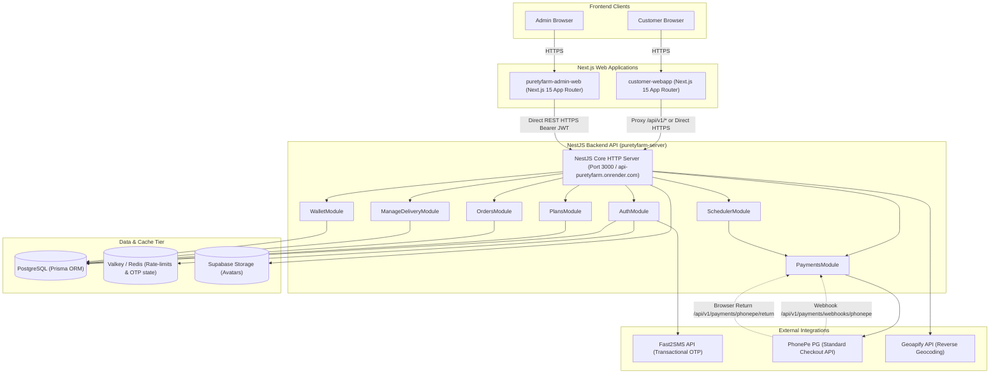
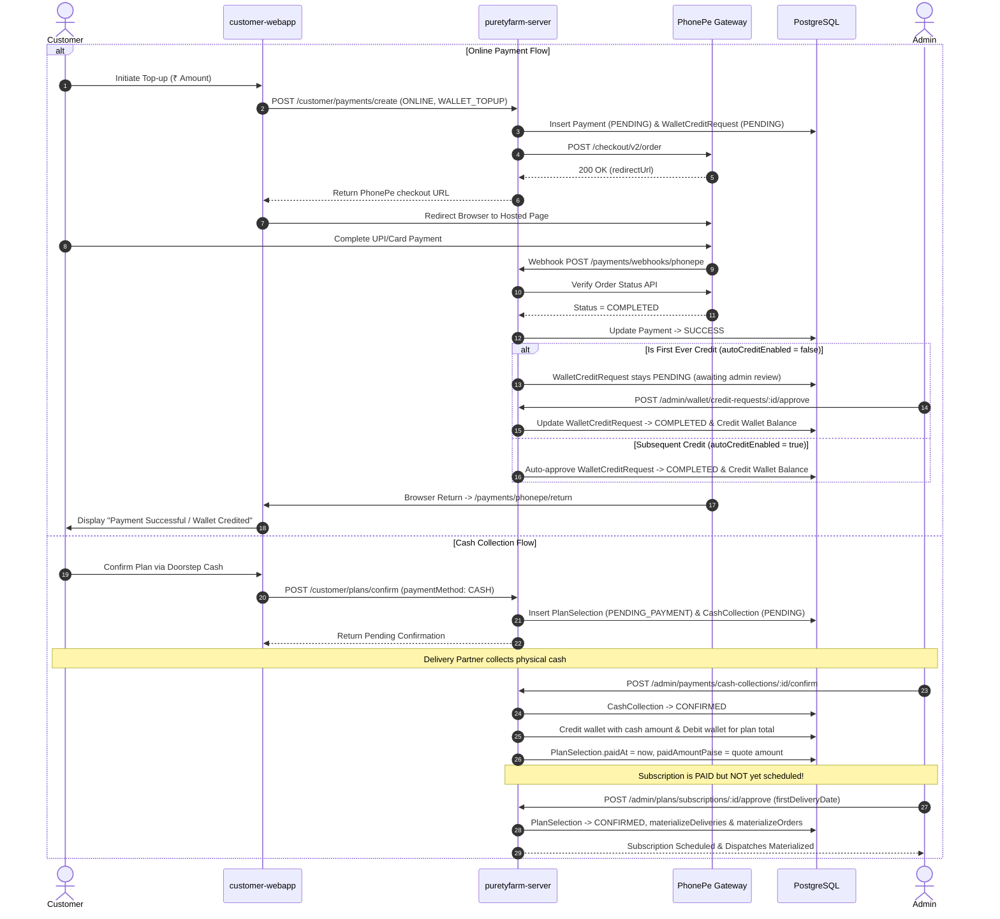
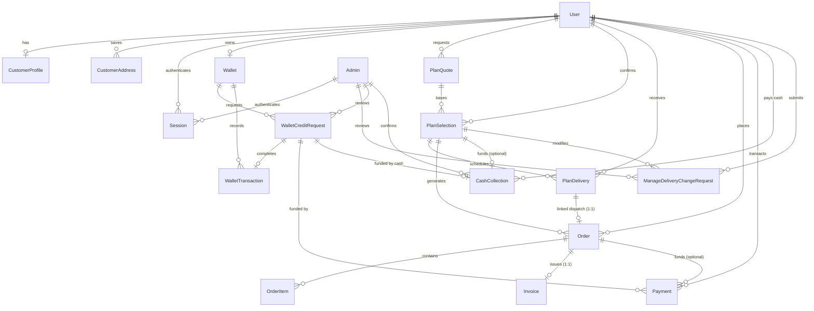

# PURETYFARM — COMPLETE CURRENT APPLICATION FLOW AUDIT & SPECIFICATION

**Audit Date:** October 11, 2026  
**Auditor Roles:** Senior Software Architect, Business Analyst, QA Engineer, NestJS Backend Auditor, Next.js Frontend Auditor, Database Workflow Specialist  
**Audit Scope:** Read-Only Source-Code Inspection & Architectural Verification  
**Repositories Inspected:**
1. `puretyfarm-server` — NestJS backend, Prisma ORM, PostgreSQL (Database URL / Valkey cache / Supabase storage).
2. `customer-webapp` — Next.js 15 (App Router) customer frontend web application.
3. `puretyfarm-admin-web` — Next.js 15 (App Router) admin portal web application.

---

## 1. TITLE & AUDIT METADATA

- **Document Title:** PuretyFarm End-to-End System Flow & Architecture Audit Report
- **Environment Context:** Linux x86_64 workspace (`/home/sahil-hode/Workspace/sevenx labs/purety farm/`)
- **Inspection Integrity:** 100% Read-Only. No code, configuration, database records, schema, or text files were added, modified, migrated, or formatted.

---

## 2. SCOPE AND READ-ONLY RESTRICTIONS

This audit document is strictly descriptive of the **current as-built code**, not an idealized architecture or proposed redesign:
1. Every workflow described reflects the exact logic, branching, exceptions, database queries, and network calls present in the source repositories.
2. Where UI exists without backend support, it is marked `UI EXISTS — BACKEND BEHAVIOR NOT VERIFIED`.
3. Where backend endpoints exist without frontend triggers, they are marked `BACKEND EXISTS — FRONTEND FLOW NOT FOUND`.
4. Where logic is blocked by exceptions, it is marked `BLOCKED — BUSINESS RULE NOT DEFINED`.
5. Exact enum values, column names, route URLs, and class methods are cited with file paths and line numbers.

---

## 3. ARCHITECTURE OVERVIEW

The PuretyFarm system comprises three distinct software tiers interacting over HTTP/REST APIs, asynchronous webhooks, and third-party SaaS services:

### Architecture Topology Diagram

### Authentication & Token Architecture
- **Customer:** Mobile number -> OTP over SMS -> Valkey-backed rate-limited session -> JWT Access Token (30m) & Refresh Token (90d) stored in client cookies/localStorage (`tokenStorage.ts`). Concurrently verified against database `sessions` table.
- **Admin:** Email/Password (Argon2 hash) -> Database Admin table verification -> JWT Access Token (30m) & Refresh Token (90d) stored in HTTP cookies/localStorage (`admin_access_token`, `admin_refresh_token`).

### Dual Route Mounting Convention
Every NestJS controller explicitly mounts on two routes: `['api/v1/...', '...']`.
Example: `@Controller(['api/v1/customer/plans', 'customer/plans'])`.
This enables frontend clients to hit `/api/v1/customer/plans` through Next.js proxy route handlers or `/customer/plans` directly without route mismatch.

---

## 4. REPOSITORY AND MODULE MAP

### 1. `puretyfarm-server` (NestJS Backend)
- `src/main.ts`: Application bootstrap, CORS validation (supports loopback, custom domains, and wildcards), global `ValidationPipe` (whitelist + transform), `PrismaExceptionFilter`.
- `src/config/env.validation.ts`: Fails fast at boot if required keys (`JWT_ACCESS_SECRET`, `JWT_REFRESH_SECRET`, `DATABASE_URL`, `VALKEY_URL`, `GEOAPIFY_API_KEY`, `PHONEPE_CLIENT_ID`, `PHONEPE_CLIENT_SECRET`, `PHONEPE_CLIENT_VERSION`, `PHONEPE_WEBHOOK_USERNAME`, `PHONEPE_WEBHOOK_PASSWORD`, `PUBLIC_API_BASE_URL`, `PAYMENT_RESULT_REDIRECT_URL`) are missing.
- `src/modules/auth/`: Customer OTP generation, Argon2 hashing, Valkey cooldowns/limits, Fast2SMS integration, Admin email/password login, JWT signing and session management (`auth.controller.ts`, `auth.service.ts`).
- `src/modules/profile/`: Customer profile CRUD, date of birth validation, Supabase avatar upload/deletion, signed URL generation (`profile.controller.ts`, `profile.service.ts`).
- `src/modules/locations/`: Geoapify reverse geocoding (`locations.controller.ts`, `locations.service.ts`, `geoapify.service.ts`), catalog of States, Cities, and Areas (`admin-locations.controller.ts`).
- `src/modules/address/`: Customer saved addresses, hierarchy validation (`address.controller.ts`, `address.service.ts`).
- `src/modules/plans/`: Plan configuration (`PlanConfig`), Buy Once, 7-Day Trial, Monthly eligibility and quote calculation (`PlanQuote`), confirmation (`confirmPlan`), delivery schedule materialization (`materializeDeliveries`), order generation (`materializeOrdersForSchedule`), admin plan configuration, and admin subscription schedule approval (`admin-plans.controller.ts`, `plans.service.ts`).
- `src/modules/payments/`: PhonePe payment intent creation, customer verify/retry/cancel, browser return redirect, PhonePe webhook handling, Cash collection tracking and admin confirmation (`payments.controller.ts`, `admin-payments.controller.ts`, `phonepe-redirect.controller.ts`, `phonepe-webhook.controller.ts`, `payments.service.ts`).
- `src/modules/orders/`: Customer order history, invoice retrieval, direct order reordering, admin order listing, bulk status updates (`bulkUpdateOrderStatus`), bulk quantity updates (`bulkUpdateOrderQuantity`), single order transitions, and order completion (`orders.controller.ts`, `admin-orders.controller.ts`, `orders.service.ts`).
- `src/modules/manage-delivery/`: Customer schedule view (`getManageDelivery`), immediate delivery skip (`skipDelivery`), change requests (`changeQuantity`, `changeFrequency`, `changePlan`, `pauseDelivery`, `resumeDelivery`), admin review (`approveRequest`, `rejectRequest`) with safety blocks on uncalculated billing changes (`manage-delivery.controller.ts`, `admin-manage-delivery.controller.ts`, `manage-delivery.service.ts`).
- `src/modules/wallet/`: Customer wallet balance, credit requests, transaction ledger, auto-credit vs admin approval rule, admin manual credit/debit (`wallet.controller.ts`, `admin-wallet.controller.ts`, `wallet.service.ts`).
- `src/modules/scheduler/`: Background cron jobs (`payment-expiry.job.ts` running every 10 minutes to expire abandoned checkout attempts).
- `src/modules/admin-dashboard/`: Administrative overview metrics, daily trends, customer counts, sales aggregates (`admin-dashboard.controller.ts`, `admin-dashboard.service.ts`).

### 2. `customer-webapp` (Next.js Customer Frontend)
- `src/app/api/v1/[...path]/route.ts`: Streaming edge proxy route forwarding browser requests to `BACKEND_URL` or `NEXT_PUBLIC_API_URL` (`https://api-puretyfarm.onrender.com`).
- `src/lib/api/client.ts`: Unified API client with automatic JWT bearer attachment, timeout handling, and 401 transparent token refresh.
- `src/features/auth/api/authApi.ts`: Client auth services for OTP request, verify, refresh, logout, profile update.
- `src/features/plans/api/plansApi.ts`: Plans overview, eligibility checks, quote generation, and confirmation.
- `src/features/payments/api/paymentsApi.ts`: Online payment initiation (form POST to PhonePe), verify, retry, cash request.
- `src/features/delivery/api/manageDeliveryApi.ts`: Upcoming deliveries calendar, skip delivery, pause, resume, change quantity/frequency/plan.
- `src/features/wallet/api/walletApi.ts`: Balance retrieval, credit requests, transaction history.
- `src/features/account/api/accountApi.ts`: Profile and address management.

### 3. `puretyfarm-admin-web` (Next.js Admin Frontend)
- `src/lib/api-client.ts`: Admin API client with transparent token rotation (`/auth/admin/refresh`), error normalization, and `pf:unauthorized` event dispatch.
- `src/services/dashboard-service.ts`: Fetches metrics from `/admin/dashboard/overview`.
- `src/services/payment-service.ts`: Lists online payments and cash collections, triggers cash confirmation/cancellation (`/admin/payments/cash-collections/:id/confirm`).
- `src/services/plan-delivery-service.ts`: Fetches plan configurations, lists subscriptions, triggers schedule approval (`/admin/plans/subscriptions/:id/approve`), reviews change requests.
- `src/services/order-service.ts`: Order lists, bulk status updates (`/admin/orders/bulk/status`), bulk quantity updates (`/admin/orders/bulk/quantity`), individual status transitions, and order completion (`/admin/orders/:id/complete`).
- `src/services/wallet-service.ts`: Lists credit requests, manual credit/debit, approve/reject credit requests.

---

## 5. CUSTOMER JOURNEY FROM A TO Z

### Step 1: Landing & Login Initiation
1. Customer visits `customer-webapp` and navigates to `/login`.
2. Customer enters a 10-digit Indian mobile number.
3. Frontend validates format (`^\d{10}$`) and calls `POST /api/v1/auth/customer/login` with `{ mobile: "XXXXXXXXXX" }`.
4. Backend `AuthService.customerLogin` runs:
   - Canonicalizes mobile number to `+91XXXXXXXXXX` (`phone.util.ts`).
   - Checks Valkey atomic rate limit script:
     - 60s resend cooldown (`auth:customer:otp:cooldown:+91...`).
     - 5 requests per 5-minute rolling window (`auth:customer:otp:send:+91...:5m`).
     - 15 requests per 24-hour daily window (`auth:customer:otp:send:+91...:daily`).
   - If limits exceeded: returns HTTP 429 (`TOO_MANY_REQUESTS`).
   - Generates 6-digit cryptographically secure OTP (`crypto.util.ts`).
   - Computes Argon2 hash of OTP and stores in Valkey with 300-second (5 min) TTL (`auth:customer:otp:+91...`).
   - Dispatches SMS via Fast2SMS API (`Fast2SmsService.sendOtp`).
   - Returns `{ success: true, message: "OTP sent successfully" }`.

### Step 2: OTP Verification & Session Provisioning
1. Customer enters 6-digit OTP into frontend.
2. Frontend submits `POST /api/v1/auth/customer/verify-otp` with `{ mobile, otp }`.
3. Backend `AuthService.customerVerifyOtp` runs:
   - Retrieves stored hash from Valkey. If missing/expired, throws HTTP 400.
   - Checks attempt counter (`auth:customer:otp:attempts:+91...`). If `>= 5`, deletes OTP and throws HTTP 400.
   - Verifies OTP against Argon2 hash. If invalid, increments attempts and returns remaining attempts.
   - Atomically consumes OTP via Lua script (`compareAndDelete`) to prevent replay attacks.
   - Finds or creates user in PostgreSQL (`users` table) with role `CUSTOMER`.
   - Generates UUID `sessionId`.
   - Signs JWT Refresh Token (90d, secret `JWT_REFRESH_SECRET`) embedding `{ sub: userId, role: "CUSTOMER", sessionId, type: "refresh" }`.
   - Computes Argon2 hash of refresh token and inserts into `sessions` table.
   - Signs JWT Access Token (30m, secret `JWT_ACCESS_SECRET`) embedding `{ sub: userId, role: "CUSTOMER", sessionId, type: "access" }`.
   - Returns `{ success: true, accessToken, refreshToken, user: { id, mobile, email, emailVerified, role } }`.
4. Frontend stores tokens via `tokenStorage.setTokens()` in localStorage and cookies, then redirects to `/dashboard` or `/onboarding`.

### Step 3: Profile & Address Setup
1. **Profile:** Customer submits `POST /api/v1/customer/profile/create-profile`:
   - Mandatory fields: `firstName`, `lastName`, `gender` (MALE/FEMALE/OTHER), `dateOfBirth` (must be past date).
   - Optional: `whatsappNumber`.
   - Stored in `customer_profiles` table.
2. **Location Detection:** Customer device GPS calls `POST /api/v1/customer/locations/detect` with `{ latitude, longitude }`:
   - Backend queries Geoapify API, matches against active `states`, `cities`, and `areas` in PostgreSQL.
   - Returns `{ serviceable: true, state, city, area, pincode, formattedAddress }` or unserviceable payload.
3. **Address Persistence:** Customer submits `POST /api/v1/customer/addresses`:
   - Requires `stateId`, `cityId`, `areaId`, `houseNumber`, `fullName`, `mobile`.
   - Backend validates State -> City -> Area hierarchy from DB catalog, denormalizes state/city/area names into address snapshot, and saves in `customer_addresses`.

### Step 4: Plan Browsing, Selection & Quoting
1. Customer navigates to `/plan`.
2. Frontend queries `GET /api/v1/customer/plans`:
   - Backend `PlansService.getPlansOverview` reads `plan_configs` table and checks eligibility:
     - **Buy Once:** Active if `SEVEN_DAY_TRIAL` has never been used, and user hasn't exceeded `maxUsages` (default 7).
     - **7-Day Trial:** Active if `BUY_ONCE` and `SEVEN_DAY_TRIAL` have never been used (strictly 1 lifetime trial).
     - **Monthly:** Always available; returns allowed frequencies (`DAILY`, `ALTERNATE_DAYS`) and modes (`FIXED`, `ALTERNATING`).
     - Returns server-authoritative `orderCutoff` policy (23:00 IST).
3. Customer selects options and requests quote:
   - `POST /api/v1/customer/plans/buy-once/quote` or `trial/quote` or `monthly/quote`.
   - Backend validates quantity against `quantityMin`/`quantityMax`.
   - Backend calculates pricing:
     - `totalLitres = quantity * deliveryOccurrences`
     - `totalActualAmount = totalLitres * actualPricePerLitre`
     - `totalSellingAmount = totalLitres * sellingPricePerLitre`
     - `discountAmount = totalActualAmount - totalSellingAmount`
   - Inserts immutable `plan_quotes` row with `status = PENDING` and 30-minute expiry (`expiresAt`).
   - Returns quote snapshot and `quoteId`.

### Step 5: Checkout & Payment
Customer proceeds to checkout with `quoteId` and chooses payment method:

#### Option A: Online Payment (via Wallet Top-up & PhonePe)
1. Customer initiates wallet top-up for the required amount:
   - `POST /api/v1/customer/payments/create` with `{ amount: amountPaise, paymentMethod: "ONLINE", purpose: "WALLET_TOPUP" }` and header `Idempotency-Key`.
   - Backend creates `wallet_credit_requests` row (`status = PENDING`, `source = ONLINE`).
   - Backend creates `payments` row (`provider = PHONEPE`, `status = PENDING`, `transactionId = PF_TXN_...`).
   - Backend calls PhonePe Order API (`/checkout/v2/order`), receives PhonePe redirect URL (`redirectUrl`).
   - Customer is redirected to PhonePe Hosted Checkout.
   - Upon completion, PhonePe redirects browser to `GET /api/v1/payments/phonepe/return?txnid=...`.
   - Concurrently, PhonePe server sends authenticated webhook to `POST /api/v1/payments/webhooks/phonepe`.
   - Webhook handler validates SHA256 auth header, checks PhonePe status API, marks `payments` row `SUCCESS`.
   - If first credit: leaves `wallet_credit_requests` in `PENDING` awaiting admin review. If subsequent credit (`autoCreditEnabled = true`): automatically executes `applyBalanceChange` crediting wallet in `wallet_transactions` ledger.
2. With sufficient balance, customer confirms plan:
   - `POST /api/v1/customer/plans/confirm` with `{ quoteId, paymentMethod: "WALLET" }`.
   - Acquires PostgreSQL transaction advisory lock on customer ID (`pg_advisory_xact_lock`).
   - Creates `plan_selections` row in `PENDING_PAYMENT`.
   - Checks wallet balance: if insufficient, aborts with 400 `INSUFFICIENT_WALLET_BALANCE`.
   - Atomically debits wallet for `quote.totalSellingAmount` creating `wallet_transactions` row (`type = DEBIT`, `referenceType = PLAN_SELECTION`).
   - Updates `plan_selections` to `status = CONFIRMED`, `paidAt = now`, `paidAmountPaise = quote.totalSellingAmount`.
   - Updates `plan_quotes` to `status = CONFIRMED`.
   - Materializes `plan_deliveries` schedule and `orders` + `invoices`.

#### Option B: Doorstep Cash Payment
1. Customer confirms plan directly with cash:
   - `POST /api/v1/customer/plans/confirm` with `{ quoteId, paymentMethod: "CASH" }`.
   - Creates `plan_selections` row in `PENDING_PAYMENT`.
   - Creates `cash_collections` row (`status = PENDING`, `amountPaise = quote.totalSellingAmount`, `planSelectionId = selection.id`).
   - Quote remains `PENDING`.
   - **Crucial:** No delivery schedule or dispatch orders are materialized at this point. Plan stays in `PENDING_PAYMENT` until physical cash is collected and confirmed by an admin.

---

## 6. ADMIN JOURNEY FROM A TO Z

### Step 1: Admin Authentication
1. Admin opens `puretyfarm-admin-web` and logs in at `/login`.
2. Frontend calls `POST /api/v1/auth/admin/login` with email and password.
3. Backend verifies email in `admins` table, verifies Argon2 password hash, creates admin session in `sessions` table, and returns access/refresh JWT tokens.
4. Tokens stored in cookies and localStorage; `apiClient` transparently handles bearer tokens and auto-refreshes on 401.

### Step 2: Dashboard Overview
1. Admin views `/` dashboard.
2. Frontend calls `GET /api/v1/admin/dashboard/overview?period=this_month`:
   - Backend queries customer counts, orders, gross sales, collected revenue, deliveries count, active subscriptions, wallet balances, and low-inventory alerts.

### Step 3: Cash Collection Management
1. When a delivery partner brings collected cash, Admin opens `/payments` (Cash Collections tab).
2. Frontend calls `GET /api/v1/admin/payments/cash-collections?status=PENDING`.
3. Admin clicks **Confirm Cash** and enters an optional note.
4. Frontend calls `POST /api/v1/admin/payments/cash-collections/:id/confirm`:
   - Backend updates `cash_collections` status to `CONFIRMED`, sets `confirmedByAdminId`, `confirmedAt`.
   - If linked to `walletCreditRequestId`: calls `walletService.creditConfirmedCashRequest` (credits wallet ledger).
   - If linked to `planSelectionId`: calls `plansService.confirmPlanAfterCashPayment`.
     - Credits wallet for collected amount.
     - Debits wallet for plan total.
     - Updates `plan_selections` with `paidAt = now`, `paidAmountPaise = quote.totalSellingAmount`.
     - **Important:** The subscription is now PAID, but still NOT active/scheduled.

### Step 4: Subscription Approval & Scheduling
1. Admin opens `/plans` (Subscriptions tab).
2. Frontend calls `GET /api/v1/admin/plans/subscriptions?status=CONFIRMED`:
   - Lists paid subscriptions awaiting scheduling or ongoing plans.
3. Admin clicks **Approve & Schedule**, selects **First Delivery Date** (e.g. tomorrow or specific calendar date), and enters approval note.
4. Frontend calls `POST /api/v1/admin/plans/subscriptions/:id/approve` with `{ firstDeliveryDate, note }`:
   - Backend verifies `selection.paidAt !== null` (rejects unconfirmed cash with `CASH_NOT_CONFIRMED`).
   - Verifies status in `APPROVABLE_SELECTION_STATUSES` (`PENDING_PAYMENT`, `CONFIRMED`, `ACTIVE`).
   - Sets `startDate = schedule.start`, `endDate = schedule.end`, `status = CONFIRMED`, `approvedByAdminId`, `approvedAt`, `approvalNote`.
   - Calls `materializeDeliveries`:
     - Computes all delivery dates based on frequency (`DAILY` or `ALTERNATE_DAYS`).
     - Reconciles existing vs target schedule.
     - Inserts `plan_deliveries` rows (`status = SCHEDULED`).
   - Calls `materializeOrdersForSchedule`:
     - Inserts dispatch `orders` rows (`status = CONFIRMED`, `paymentStatus = PAID`).
     - Creates line items in `order_items` and financial records in `invoices`.
5. Customer can now see active subscription and upcoming deliveries on their delivery calendar.

### Step 5: Delivery & Order Management
1. Admin navigates to `/deliveries` or `/orders`.
2. Views daily dispatch lists filtered by `deliveryDate = YYYY-MM-DD`.
3. Admin can perform:
   - **Individual Status Transition:** `PATCH /api/v1/admin/orders/:id/status` (e.g., CONFIRMED -> DELIVERED). Linked `plan_deliveries` row is synchronized to `DELIVERED`.
   - **Bulk Mark Delivered:** Selects multiple orders, clicks "Mark Delivered" -> `PATCH /api/v1/admin/orders/bulk/status` with `{ orderIds, status: "DELIVERED" }`.
   - **Bulk Quantity Edit:** Selects upcoming orders -> `PATCH /api/v1/admin/orders/bulk/quantity` with `{ orderIds, quantity: 2 }`.
   - **Order Completion:** Once delivered and date is past, clicks "Complete" -> `PATCH /api/v1/admin/orders/:id/complete` (accounting close, `status = COMPLETED`).

### Step 6: Change Request Review
1. Admin opens `/plans` (Requests tab).
2. Frontend queries `GET /api/v1/admin/manage-delivery/requests?status=PENDING`.
3. Admin reviews customer requests:
   - If `CHANGE_FREQUENCY`, `PAUSE`, or `RESUME`: Admin clicks **Approve** (`POST /api/v1/admin/manage-delivery/requests/:id/approve`). Backend applies schedule adjustment.
   - If `CHANGE_QUANTITY` or `CHANGE_PLAN`: Admin approval is **intentionally blocked** by the backend throwing `NotImplementedException` (due to missing prepaid financial reconciliation rules). Admin must reject with note or request remains pending.

---

## 7. PAYMENT AND APPROVAL WORKFLOW

---

## 8. SUBSCRIPTION ACTIVATION WORKFLOW

### Persisted Eligibility Rules
- **BUY_ONCE:** Max usages per account = `PlanConfig.maxUsages` (default 7). Completely blocked if user has ever used `SEVEN_DAY_TRIAL`.
- **SEVEN_DAY_TRIAL:** Exactly 1 usage per account lifetime. Completely blocked if user has ever used `BUY_ONCE`.
- **MONTHLY:** No lifetime usage limit. Requires selecting `frequency` (`DAILY` or `ALTERNATE_DAYS`) and `quantityMode` (`FIXED` or `ALTERNATING`).

### Status Lifecycle of a Plan Selection
1. `PENDING_PAYMENT`: Created upon checkout confirmation. Awaiting wallet debit or cash confirmation.
2. `CONFIRMED`: Payment received and schedule approved by admin (or materialized via inline wallet payment). Deliveries active.
3. `ACTIVE`: Identical operational meaning to `CONFIRMED` in the current codebase.
4. `PAUSED`: Admin approved vacation/pause request. Future scheduled deliveries marked `SKIPPED`.
5. `COMPLETED`: Delivery schedule window has fully elapsed.
6. `CANCELLED`: Terminal cancellation.

---

## 9. SCHEDULE AND ORDER GENERATION WORKFLOW

### The `resolveFirstDeliveryDate` Algorithm (`plans.service.ts:L298-L303`)
- PuretyFarm does not support same-day delivery. Morning dispatch is loaded the prior evening.
- **Order Cutoff Time:** 23:00 IST (`ORDER_CUTOFF_HHMM = "23:00"`).
- If order placed **before 23:00 IST**: `leadDays = 1` -> First delivery date is **Tomorrow**.
- If order placed **at or after 23:00 IST**: `leadDays = 2` -> First delivery date is **Day after tomorrow**.
- Computed strictly in `Asia/Kolkata` timezone (`toIstDateOnly`), immune to server container UTC drift.

### Non-Destructive Schedule Reconciliation (`reconcileScheduleWindow`)
When an admin approves or updates a schedule:
1. `DELIVERED` or `SKIPPED` rows are **never touched** (fulfilment history is immutable).
2. Existing `SCHEDULED` deliveries matching target dates are **kept** with their linked orders (prevents duplicate orders or invoice burning).
3. Existing `SCHEDULED` deliveries no longer wanted whose orders have advanced past `CONFIRMED` (e.g. `OUT_FOR_DELIVERY`) are **kept** (physical reality takes precedence).
4. Only unfulfilled `SCHEDULED` deliveries no longer wanted whose orders are `PENDING` or `CONFIRMED` are stood down:
   - Order status updated to `CANCELLED` (never deleted; preserves invoice sequence).
   - Delivery row status updated to `SKIPPED`.
5. Genuine new dates are created in `plan_deliveries` (`skipDuplicates: true`).
6. `materializeOrdersForSchedule` runs to mint dispatch orders for any unlinked scheduled deliveries.

---

## 10. DELIVERY MANAGEMENT WORKFLOW

### Customer Upcoming Deliveries
- Frontend queries `GET /api/v1/customer/manage-delivery`.
- Backend returns:
  - `activePlan`: Details of current plan selection, start/end dates, delivery window.
  - `upcomingDeliveries`: Array of scheduled deliveries (`deliveryDate`, `quantityLitres`, `status`).
  - `summary`: Total scheduled, delivered, and skipped counts.

### Customer Skip Delivery (`skipDelivery`)
- Route: `POST /api/v1/customer/manage-delivery/skip` with `{ deliveryDate: "YYYY-MM-DD" }`.
- Immediate customer action; **no admin approval required**.
- Backend validations:
  - `deliveryDate` must be strictly in the future (`> today` in IST).
  - Delivery must exist for active plan and have status `SCHEDULED`.
- Database updates:
  - `plan_deliveries.status` updated from `SCHEDULED` to `SKIPPED`.
  - Linked `orders` row (if status is `PENDING` or `CONFIRMED`) updated to `CANCELLED`.
  - If order is already `OUT_FOR_DELIVERY` or `DELIVERED`, order is preserved untouched.
- **Financial Effect:** **NONE**. No wallet credit, refund, or ledger entry occurs. Money paid remains captured at plan level.

---

## 11. CUSTOMER CHANGE-REQUEST WORKFLOW

| Request Type | Trigger Endpoint | DB Record Created | Approval Endpoint | Implemented Behavior / Backend Outcome |
| :--- | :--- | :--- | :--- | :--- |
| **SKIP** | `POST /customer/manage-delivery/skip` | None (Direct Delivery Update) | N/A (Immediate) | **IMPLEMENTED**: Delivery marked `SKIPPED`, order `CANCELLED`. No refund. |
| **PAUSE** | `POST /customer/manage-delivery/pause` | `ManageDeliveryChangeRequest` (PAUSE, PENDING) | `POST /admin/manage-delivery/requests/:id/approve` | **IMPLEMENTED**: Plan moves to `PAUSED`. Deliveries in pause window marked `SKIPPED`, orders `CANCELLED`. Paused IDs saved in request JSON. |
| **RESUME** | `POST /customer/manage-delivery/resume` | `ManageDeliveryChangeRequest` (RESUME, PENDING) | `POST /admin/manage-delivery/requests/:id/approve` | **IMPLEMENTED**: Plan moves to `CONFIRMED`. Restores exact paused delivery IDs that are future, regenerates cadence, creates dispatch orders using frozen price snapshot. |
| **CHANGE_FREQUENCY** | `POST /customer/manage-delivery/change-frequency` | `ManageDeliveryChangeRequest` (CHANGE_FREQUENCY, PENDING) | `POST /admin/manage-delivery/requests/:id/approve` | **IMPLEMENTED**: Reconciles future schedule, stands down dropped dates, materializes new dates & orders using frozen price snapshot. |
| **CHANGE_QUANTITY** | `POST /customer/manage-delivery/change-quantity` | `ManageDeliveryChangeRequest` (CHANGE_QUANTITY, PENDING) | `POST /admin/manage-delivery/requests/:id/approve` | **BLOCKED**: Throws `NotImplementedException(501)`. System blocks approval because prepaid price/order/invoice reconciliation rules are undefined. |
| **CHANGE_PLAN** | `POST /customer/manage-delivery/change-plan` | `ManageDeliveryChangeRequest` (CHANGE_PLAN, PENDING) | `POST /admin/manage-delivery/requests/:id/approve` | **BLOCKED**: Throws `NotImplementedException(501)`. System blocks approval because duration, pricing, and invoice reconciliation rules are undefined. |

---

## 12. WALLET AND FINANCIAL WORKFLOW

### Principles of Money Movement in PuretyFarm
1. **The Separation of Concerns:**
   - `Payment` model tracks external money movement (PhonePe transactions).
   - `CashCollection` model tracks physical cash collected by delivery partners.
   - `Wallet` & `WalletTransaction` own customer balances and ledger entries.
   - Payments never modify wallet balance directly; they gate a `WalletCreditRequest`.
2. **First-Credit Rule:**
   - Every customer wallet starts with `autoCreditEnabled = false`.
   - A customer's **first ever online top-up** requires manual admin approval via `POST /api/v1/admin/wallet/credit-requests/:id/approve`.
   - Upon first approval, `wallet.autoCreditEnabled` is atomically set to `true`.
   - Subsequent verified online payments auto-credit the wallet immediately.
   - Cash top-ups **never** auto-credit; admin confirmation of cash is always required.
3. **Prepaid Billing Model:**
   - Plan purchases are paid **100% upfront** (either by debiting the wallet or via cash collection).
   - Deliveries and orders do **NOT** generate individual wallet debits. Dispatch orders are created with `paymentStatus = PAID`.
   - Skipping a delivery does **NOT** issue a wallet credit or refund.
   - Admin bulk quantity updates on upcoming orders alter `order_items` and `orders.totalPaise`, but do **NOT** adjust wallet balance or issue refunds.

---

## 13. DATABASE RELATIONSHIPS

### Entity Foreign Key Reference Table

| Entity | Primary Key | Foreign Key Field | References Entity | On Delete Action | Source of Truth For |
| :--- | :--- | :--- | :--- | :--- | :--- |
| `CustomerProfile` | `id` | `userId` | `User.id` | CASCADE | Personal details (name, DOB, gender) |
| `CustomerAddress` | `id` | `userId` `stateId` `cityId` `areaId` | `User.id` `State.id` `City.id` `Area.id` | CASCADE RESTRICT RESTRICT RESTRICT | Authoritative saved delivery locations |
| `PlanSelection` | `id` | `userId` `quoteId` | `User.id` `PlanQuote.id` | CASCADE RESTRICT | Live subscription schedule config & payment audit |
| `PlanDelivery` | `id` | `selectionId` `userId` | `PlanSelection.id` `User.id` | CASCADE CASCADE | Individual daily delivery status & quantity |
| `Order` | `id` | `userId` `planSelectionId` `planDeliveryId` | `User.id` `PlanSelection.id` `PlanDelivery.id` | CASCADE SET NULL SET NULL | Dispatch execution, pricing snapshot, fulfillment |
| `OrderItem` | `id` | `orderId` | `Order.id` | CASCADE | Line item quantities and unit price snapshot |
| `Invoice` | `id` | `orderId` | `Order.id` | CASCADE | Immutable legal tax/billing snapshot |
| `WalletCreditRequest`| `id` | `walletId` `reviewedByAdminId` | `Wallet.id` `Admin.id` | CASCADE SET NULL | Top-up request lifecycle and admin review audit |
| `WalletTransaction` | `id` | `walletId` `creditRequestId` | `Wallet.id` `WalletCreditRequest.id`| CASCADE SET NULL | Immutable financial ledger & running balance |
| `Payment` | `id` | `userId` `orderId` `walletCreditRequestId` | `User.id` `Order.id` `WalletCreditRequest.id` | CASCADE SET NULL SET NULL | Payment gateway transaction and verification state |
| `CashCollection` | `id` | `userId` `walletCreditRequestId` `planSelectionId` `confirmedByAdminId` | `User.id` `WalletCreditRequest.id` `PlanSelection.id` `Admin.id` | CASCADE CASCADE CASCADE SET NULL | Physical cash handover and admin confirmation gate |

---

## 14. STATUS INVENTORY AND TRANSITION TABLES

### 1. Order Status (`OrderStatus`)
Enums: `PENDING`, `CONFIRMED`, `PROCESSING`, `OUT_FOR_DELIVERY`, `DELIVERED`, `COMPLETED`, `CANCELLED`, `FAILED`.

| Current Status | Target Status | Allowed? | Conditions / Method | PlanDelivery Effect | Customer Visible Result |
| :--- | :--- | :--- | :--- | :--- | :--- |
| `PENDING` | `CONFIRMED` | Yes | Payment completed or manual admin update | None | "Order Confirmed" |
| `PENDING` | `CANCELLED` | Yes | Payment expired or customer/admin cancel | If linked, stays or skipped | "Order Cancelled" |
| `PENDING` | `FAILED` | Yes | Payment gateway failure | None | "Payment Failed" |
| `CONFIRMED` | `DELIVERED` | Yes | `updateOrderStatus` or `bulkUpdateOrderStatus` | Synchronized to `DELIVERED` | "Delivered" |
| `CONFIRMED` | `PROCESSING` | Yes | Dispatch warehouse processing | None | "Processing" |
| `CONFIRMED` | `CANCELLED` | Yes | Customer skipped delivery or schedule stand-down | Marked `SKIPPED` | "Cancelled / Skipped" |
| `PROCESSING` | `OUT_FOR_DELIVERY` | Yes | Delivery partner dispatched | None | "Out for Delivery" |
| `PROCESSING` | `DELIVERED` | Yes | Admin delivery update | Synchronized to `DELIVERED` | "Delivered" |
| `PROCESSING` | `CANCELLED` | Yes | Administrative stand-down | Marked `SKIPPED` | "Cancelled" |
| `OUT_FOR_DELIVERY` | `DELIVERED` | Yes | Partner completed delivery run | Synchronized to `DELIVERED` | "Delivered" |
| `OUT_FOR_DELIVERY` | `FAILED` | Yes | Delivery partner could not deliver | None | "Delivery Failed" |
| `DELIVERED` | `COMPLETED` | Yes | `completeOrder`: Delivery date must be today or past; delivery not skipped | None (Delivery remains `DELIVERED`) | "Completed" (Order closed) |
| `COMPLETED` | *Any* | **No** | Terminal status | N/A | Terminal |
| `CANCELLED` | *Any* | **No** | Terminal status | N/A | Terminal |
| `FAILED` | *Any* | **No** | Terminal status | N/A | Terminal |

### 2. Plan Delivery Status (`DeliveryStatus`)
Enums: `SCHEDULED`, `SKIPPED`, `DELIVERED`.
- `SCHEDULED`: Initial state upon materialization.
- `SKIPPED`: Set when customer calls `skipDelivery`, plan is paused, or date is stood down during schedule reconciliation.
- `DELIVERED`: Set when admin updates linked `Order` to `DELIVERED`.

> [!NOTE]
> `PlanDelivery` does NOT have an `actualDeliveryTimestamp` or `deliveredAt` column. Only `createdAt` and `updatedAt` exist. The delivery day is represented solely by `deliveryDate` (`@db.Date`).

### 3. Plan Selection Status (`PlanSelectionStatus`)
Enums: `PENDING_PAYMENT`, `CONFIRMED`, `ACTIVE`, `PAUSED`, `COMPLETED`, `CANCELLED`.
- `PENDING_PAYMENT`: Awaiting wallet debit or cash confirmation.
- `CONFIRMED` / `ACTIVE`: Paid and scheduled. Active for deliveries.
- `PAUSED`: Suspended via admin approval of customer pause request.
- `COMPLETED`: Schedule window elapsed.
- `CANCELLED`: Terminal cancellation.

### 4. Payment Transaction Status (`PaymentTransactionStatus`)
Enums: `PENDING`, `PROCESSING`, `SUCCESS`, `FAILED`, `CANCELLED`, `EXPIRED`, `REFUND_PENDING`, `REFUNDED`.

### 5. Cash Collection Status (`CashCollectionStatus`)
Enums: `PENDING`, `COLLECTED`, `CONFIRMED`, `CANCELLED`.

### 6. Change Request Status (`ChangeRequestStatus`)
Enums: `PENDING`, `APPROVED`, `REJECTED`.

### 7. Wallet Credit Request Status (`WalletCreditRequestStatus`)
Enums: `PENDING`, `COMPLETED`, `REJECTED`, `CANCELLED`.

---

## 15. API INVENTORY

| Actor | Method | Endpoint | Controller | Service Method | Purpose | Auth / Guard | DB Mutation |
| :--- | :--- | :--- | :--- | :--- | :--- | :--- | :--- |
| Customer | POST | `/api/v1/auth/customer/login` | `AuthController` | `customerLogin` | Send OTP via SMS | Public | Valkey rate-limits & hash |
| Customer | POST | `/api/v1/auth/customer/verify-otp` | `AuthController` | `customerVerifyOtp` | Verify OTP & issue JWT | Public | `users`, `sessions` |
| Customer | POST | `/api/v1/auth/customer/refresh` | `AuthController` | `customerRefreshToken` | Rotate refresh token | Public | `sessions` |
| Customer | POST | `/api/v1/auth/customer/logout` | `AuthController` | `customerLogout` | Revoke session | Customer JWT | `sessions.revokedAt` |
| Customer | GET | `/api/v1/customer/profile/me` | `ProfileController` | `getCustomerProfile` | Get profile details | Customer JWT | None (Read) |
| Customer | POST | `/api/v1/customer/profile/create-profile`| `ProfileController` | `createCustomerProfile` | Create profile | Customer JWT | `customer_profiles` |
| Customer | POST | `/api/v1/customer/locations/detect` | `LocationsController` | `detectLocation` | Reverse geocode coordinates| Customer JWT | None (Geoapify call) |
| Customer | GET | `/api/v1/customer/addresses` | `AddressController` | `getAddresses` | List saved addresses | Customer JWT | None (Read) |
| Customer | POST | `/api/v1/customer/addresses` | `AddressController` | `createAddress` | Add delivery address | Customer JWT | `customer_addresses` |
| Customer | GET | `/api/v1/customer/plans` | `PlansController` | `getPlansOverview` | Browse plans & limits | Customer JWT | None (Read) |
| Customer | POST | `/api/v1/customer/plans/monthly/quote` | `PlansController` | `createMonthlyQuote` | Calculate monthly quote | Customer JWT | `plan_quotes` |
| Customer | POST | `/api/v1/customer/plans/confirm` | `PlansController` | `confirmPlan` | Confirm plan purchase | Customer JWT | `plan_selections`, `wallet_transactions`, `cash_collections` |
| Customer | POST | `/api/v1/customer/payments/create` | `PaymentsController` | `createWalletTopUp` | Initiate PhonePe payment | Customer JWT | `payments`, `wallet_credit_requests` |
| Customer | POST | `/api/v1/customer/payments/verify` | `PaymentsController` | `verifyPayment` | Re-check PhonePe status | Customer JWT | `payments`, `wallet_credit_requests` |
| Customer | GET | `/api/v1/customer/wallet` | `WalletController` | `getWallet` | Get balance & ledger | Customer JWT | None (Read) |
| Customer | GET | `/api/v1/customer/manage-delivery` | `ManageDeliveryController`| `getManageDelivery` | View delivery calendar | Customer JWT | None (Read) |
| Customer | POST | `/api/v1/customer/manage-delivery/skip`| `ManageDeliveryController`| `skipDelivery` | Skip upcoming delivery | Customer JWT | `plan_deliveries`, `orders` |
| Customer | POST | `/api/v1/customer/manage-delivery/pause`| `ManageDeliveryController`| `pauseDelivery` | Request vacation pause | Customer JWT | `manage_delivery_change_requests` |
| Customer | POST | `/api/v1/customer/manage-delivery/resume`| `ManageDeliveryController`| `resumeDelivery` | Request plan resume | Customer JWT | `manage_delivery_change_requests` |
| Admin | POST | `/api/v1/auth/admin/login` | `AuthController` | `adminLogin` | Admin login | Public | `sessions` |
| Admin | GET | `/api/v1/admin/dashboard/overview` | `AdminDashboardController`| `getOverview` | KPI & sales metrics | Admin JWT | None (Read) |
| Admin | GET | `/api/v1/admin/payments/cash-collections`| `AdminPaymentsController` | `getAdminCashCollections`| List cash collections | Admin JWT | None (Read) |
| Admin | POST | `/api/v1/admin/payments/cash-collections/:id/confirm`| `AdminPaymentsController`| `confirmCashCollection`| Confirm cash & fund plan| Admin JWT | `cash_collections`, `wallet_transactions`, `plan_selections` |
| Admin | GET | `/api/v1/admin/plans/subscriptions` | `AdminPlansController` | `getAdminSubscriptions` | List subscriptions | Admin JWT | None (Read) |
| Admin | POST | `/api/v1/admin/plans/subscriptions/:id/approve`| `AdminPlansController` | `adminApproveSubscription`| Approve & schedule plan | Admin JWT | `plan_selections`, `plan_deliveries`, `orders`, `invoices` |
| Admin | GET | `/api/v1/admin/orders` | `AdminOrdersController` | `getAdminOrders` | List orders & dispatches| Admin JWT | None (Read) |
| Admin | PATCH| `/api/v1/admin/orders/:id/status` | `AdminOrdersController` | `updateOrderStatus` | Update order status | Admin JWT | `orders`, `plan_deliveries` |
| Admin | PATCH| `/api/v1/admin/orders/bulk/status` | `AdminOrdersController` | `bulkUpdateOrderStatus` | Bulk mark delivered | Admin JWT | `orders`, `plan_deliveries` |
| Admin | PATCH| `/api/v1/admin/orders/bulk/quantity`| `AdminOrdersController` | `bulkUpdateOrderQuantity`| Bulk edit delivery qty | Admin JWT | `orders`, `order_items`, `plan_deliveries` |
| Admin | PATCH| `/api/v1/admin/orders/:id/complete` | `AdminOrdersController` | `completeOrder` | Accounting close | Admin JWT | `orders.status = COMPLETED` |
| Admin | GET | `/api/v1/admin/manage-delivery/requests`| `AdminManageDeliveryController`| `getAdminRequests` | List change requests | Admin JWT | None (Read) |
| Admin | POST | `/api/v1/admin/manage-delivery/requests/:id/approve`| `AdminManageDeliveryController`| `approveRequest` | Approve change request | Admin JWT | `manage_delivery_change_requests`, `plan_selections`, `plan_deliveries` |
| Admin | POST | `/api/v1/admin/manage-delivery/requests/:id/reject`| `AdminManageDeliveryController`| `rejectRequest` | Reject change request | Admin JWT | `manage_delivery_change_requests` |

---

## 16. ERROR AND FAILURE HANDLING

1. **OTP Rate Limit Exceeded:** HTTP 429 (`TOO_MANY_REQUESTS`) with messages:
   - "Please wait before requesting another OTP" (cooldown < 60s).
   - "Too many OTP requests. Please try again after 5 minutes." (> 5 in 5m).
   - "Daily OTP limit exceeded. Please try again tomorrow." (> 15 in 24h).
2. **Expired / Invalid Quote:** HTTP 400 (`BadRequestException`) "Quote has expired" or "Quote is no longer pending".
3. **Insufficient Wallet Balance:** HTTP 400 with structured payload:
   `{ error: "INSUFFICIENT_WALLET_BALANCE", message: "Insufficient wallet balance...", currentBalancePaise, requiredPaise, shortfallPaise, shortfallRupees }`.
4. **Subscription Approval without Payment:** HTTP 400:
   - If cash unconfirmed: `{ error: "CASH_NOT_CONFIRMED", message: "Physical cash receipt has not been confirmed yet..." }`.
   - If general unpaid: `{ error: "SUBSCRIPTION_NOT_PAID", message: "This subscription has no confirmed payment..." }`.
5. **Concurrent Approval / Update Conflicts:** Handled via conditional SQL queries (`updateMany` checking starting status). If rows affected == 0, throws HTTP 409 (`ConflictException`) with message "This subscription was updated by another request. Reload it and try again."
6. **Past Delivery Skip Attempt:** HTTP 400 "Only future deliveries can be skipped".
7. **Change Quantity Approval:** HTTP 501 (`NotImplementedException`) "Approving quantity changes is temporarily disabled...".

---

## 17. SECURITY AND TRANSACTION-SAFETY OBSERVATIONS

1. **IDOR Protections:** All customer controller methods derive `userId` strictly from the decoded JWT payload (`user.sub`). Body fields named `userId` or `adminId` are ignored or forbidden by `ValidationPipe({ whitelist: true })`.
2. **PostgreSQL Advisory Locks:** `confirmPlan` uses explicit transactional session advisory locks:
   `SELECT pg_advisory_xact_lock(hashtextextended(${userId}, 0))` preventing racing double-confirmation of quotes or double-debiting of wallets.
3. **Webhook Verification:** PhonePe webhooks are authenticated via SHA256 header comparison with `PHONEPE_WEBHOOK_PASSWORD`. The webhook payload is never trusted alone; the server makes an authoritative server-to-server call to PhonePe's Order Status API.
4. **Safe Currency Arithmetic:** All monetary amounts across quotes, plans, wallets, orders, and invoices are stored strictly as **integer paise** (`Int`), completely eliminating floating-point rounding bugs.

---

## 18. FEATURE CLASSIFICATION

- **Customer Registration & OTP Login:** `IMPLEMENTED — CODE VERIFIED`
- **Customer Profile & Supabase Avatar Upload:** `IMPLEMENTED — CODE VERIFIED`
- **Location Catalog & Geoapify Detection:** `IMPLEMENTED — CODE VERIFIED`
- **Saved Address Management:** `IMPLEMENTED — CODE VERIFIED`
- **Plan Quoting & Eligibility Constraints:** `IMPLEMENTED — CODE VERIFIED`
- **Prepaid Wallet Checkout:** `IMPLEMENTED — CODE VERIFIED`
- **Doorstep Cash Checkout & Collection Tracking:** `IMPLEMENTED — CODE VERIFIED`
- **PhonePe Online Payment Integration & Webhook:** `IMPLEMENTED — CODE VERIFIED`
- **Wallet Top-up First-Credit Approval Rule:** `IMPLEMENTED — CODE VERIFIED`
- **Admin Cash Collection Confirmation:** `IMPLEMENTED — CODE VERIFIED`
- **Admin Subscription Schedule Approval:** `IMPLEMENTED — CODE VERIFIED`
- **Automated Dispatch Order & Invoice Materialization:** `IMPLEMENTED — CODE VERIFIED`
- **Customer Skip Delivery (Immediate):** `IMPLEMENTED — CODE VERIFIED`
- **Customer Pause & Resume Requests:** `IMPLEMENTED — CODE VERIFIED`
- **Customer Change Frequency Approval:** `IMPLEMENTED — CODE VERIFIED`
- **Customer Change Quantity Approval:** `BLOCKED — BUSINESS RULE NOT DEFINED` (Throws 501)
- **Customer Change Plan Approval:** `BLOCKED — BUSINESS RULE NOT DEFINED` (Throws 501)
- **Admin Bulk Mark Delivered:** `IMPLEMENTED — CODE VERIFIED`
- **Admin Bulk Quantity Update:** `PARTIALLY IMPLEMENTED` (Updates order/delivery items, but does not adjust invoices or wallet/plan billing)
- **Admin Order Completion (Accounting Close):** `IMPLEMENTED — CODE VERIFIED`
- **Scheduler Payment Expiry Cron (Every 10 min):** `IMPLEMENTED — CODE VERIFIED`

---

## 19. DISCREPANCIES & ARCHITECTURAL GAPS

1. **Bulk Quantity Discrepancy:**
   When an admin runs `bulkUpdateOrderQuantity` on upcoming orders, it updates `orders.totalPaise` and `plan_deliveries.quantityLitres`, but leaves `invoices.financialSnapshot`, `plan_selections.paidAmountPaise`, and the customer's wallet balance unchanged. This creates an un-reconciled financial drift between collected revenue and modified order totals.
2. **Missing `deliveredAt` Timestamp on `PlanDelivery`:**
   The `PlanDelivery` model tracks only `deliveryDate` (`@db.Date`), `status`, and system timestamps `createdAt`/`updatedAt`. There is no dedicated timestamp recording the exact time the delivery partner delivered the milk.
3. **Customer Webapp Mock Route Fallbacks:**
   `customer-webapp` contains some fallback logic to local Next.js `/api/*` endpoints (e.g. in `accountApi.ts` for addresses), though primary flows route via `/api/v1/*` proxy to NestJS.
4. **No Per-Delivery Debits:**
   The application is completely prepaid. Money is captured at purchase time, and no delivery-level financial deduction exists.

---

## 20. EXACT SOURCE-CODE EVIDENCE MAP

| Flow / Logic | Repository | File Path | Line Range | Key Functions / Decorators |
| :--- | :--- | :--- | :--- | :--- |
| OTP Generation & Limits | `puretyfarm-server` | `src/modules/auth/auth.service.ts` | L115–L190 | `customerLogin`, `reserveSendSlot` |
| OTP Verification & Session | `puretyfarm-server` | `src/modules/auth/auth.service.ts` | L195–L300 | `customerVerifyOtp`, `compareAndDelete` |
| Order Cutoff & Lead Days | `puretyfarm-server` | `src/modules/plans/plans.service.ts` | L270–L310 | `resolveFirstDeliveryDate`, `getOrderCutoffPolicy` |
| Plan Confirmation (Wallet & Cash)| `puretyfarm-server` | `src/modules/plans/plans.service.ts` | L862–L1050 | `confirmPlan`, `pg_advisory_xact_lock` |
| Cash Payment Settlement | `puretyfarm-server` | `src/modules/plans/plans.service.ts` | L1470–L1515| `confirmPlanAfterCashPayment` |
| Subscription Schedule Approval | `puretyfarm-server` | `src/modules/plans/plans.service.ts` | L1519–L1640| `adminApproveSubscription` |
| Order & Invoice Materialization | `puretyfarm-server` | `src/modules/plans/plans.service.ts` | L1263–L1460| `materializeOrdersForSchedule` |
| Skip Delivery | `puretyfarm-server` | `src/modules/manage-delivery/manage-delivery.service.ts` | L138–L230 | `skipDelivery` |
| Blocked Quantity Approval | `puretyfarm-server` | `src/modules/manage-delivery/manage-delivery.service.ts` | L840–L870 | `blockQuantityChangeApproval` (501) |
| Blocked Plan Change Approval | `puretyfarm-server` | `src/modules/manage-delivery/manage-delivery.service.ts` | L1250–L1280| `blockPlanChangeApproval` (501) |
| Bulk Mark Delivered | `puretyfarm-server` | `src/modules/orders/orders.service.ts` | L666–L815 | `bulkUpdateOrderStatus` |
| Bulk Quantity Update | `puretyfarm-server` | `src/modules/orders/orders.service.ts` | L818–L995 | `bulkUpdateOrderQuantity` |
| Order Completion | `puretyfarm-server` | `src/modules/orders/orders.service.ts` | L1001–L1085| `completeOrder` |
| Cash Collection Confirmation | `puretyfarm-server` | `src/modules/payments/payments.service.ts` | L2090–L2195| `confirmCashCollection` |
| First-Credit Wallet Rule | `puretyfarm-server` | `src/modules/wallet/wallet.service.ts` | L1043–L1145| `settleAfterVerifiedPayment` |
| Next.js API Proxy | `customer-webapp` | `src/app/api/v1/[...path]/route.ts` | L1–L95 | `proxyRequest` |
| Customer Auth Client | `customer-webapp` | `src/features/auth/api/authApi.ts` | L1–L150 | `sendOtp`, `verifyOtp` |
| Admin Plan & Subscriptions API | `puretyfarm-admin-web`| `src/services/plan-delivery-service.ts` | L360–L510 | `fetchAdminSubscriptions`, `approveSubscription` |

---

## 21. QUESTIONS NOT ANSWERABLE FROM CODE ALONE

1. **Delivery Partner Field App Handshake:**
   The repository `delivery-partner-app` is empty (0 bytes). How delivery partners currently authenticate and mark cash collected in the field is not present in these three repositories.
2. **Production PhonePe Merchant Settlement Schedule:**
   Whether PhonePe T+1 or T+2 settlement matches bank reconciliations is external to the code.
3. **SMS Delivery Gateway Performance:**
   Fast2SMS delivery latency in production cannot be measured from static source inspection.

---

## 22. FINAL SYSTEM SUMMARY

The PuretyFarm system as it exists today is a **cohesive, highly structured, ACID-compliant prepaid dairy subscription engine**:
- It enforces strict separation of money movement (`Payment`), physical cash confirmation (`CashCollection`), wallet balance (`Wallet`), and dispatch fulfillment (`Order`/`PlanDelivery`).
- Financial numbers are integer paise, preventing floating-point discrepancies.
- Concurrent races on OTPs, sessions, wallet debits, and status transitions are guarded with Lua scripts, PostgreSQL advisory locks, and atomic conditional SQL updates.
- Scheduling and order generation are non-destructive and preserve legal invoice sequences.
- Business gaps (like quantity changes on prepaid plans) are defensively blocked with `501 NotImplementedException` to prevent corruption of immutable financial history.

---

## 23. FINAL VERIFICATION CHECKLIST (Direct Answers to 22 Questions)

1. **What exactly happens when a customer places an order?**  
   The customer selects options, requests a quote (`PlanQuote`), and confirms it via `POST /api/v1/customer/plans/confirm`. A `PlanSelection` row is created in `PENDING_PAYMENT`. If paying via wallet, the wallet is debited and deliveries/orders are materialized immediately. If paying via cash, a `CashCollection` row is created in `PENDING` and orders are NOT created yet.
2. **What record is created first?**  
   The `PlanQuote` record (in `PENDING` status with a 30-minute expiry) is created first.
3. **When is payment confirmed?**  
   For online payments: when PhonePe webhook/status verification confirms `SUCCESS`. For cash payments: when an admin clicks Confirm Cash in the admin portal (`POST /api/v1/admin/payments/cash-collections/:id/confirm`).
4. **Who approves cash collection?**  
   An authenticated administrator with the `ADMIN` role via the admin web portal.
5. **Who approves the subscription?**  
   An administrator with the `ADMIN` role via `POST /api/v1/admin/plans/subscriptions/:id/approve` on the Subscriptions tab.
6. **When is the subscription considered active?**  
   When `plan_selections.status` is updated to `CONFIRMED` and `approvedAt` is stamped, making it visible on the customer's delivery calendar.
7. **When and how are delivery schedules generated?**  
   Generated during `materializeDeliveries` by computing all dates between the first delivery date and the end date based on the plan frequency (`DAILY` or `ALTERNATE_DAYS`).
8. **When are dispatch orders created?**  
   Immediately following delivery schedule materialization via `materializeOrdersForSchedule`. One `Order` and one `Invoice` are created per `SCHEDULED` delivery.
9. **How are duplicate schedules or orders prevented?**  
   Via a database unique constraint `@@unique([selectionId, deliveryDate])` on `PlanDelivery`, conditional SQL queries (`where: { planDeliveryId: { in: deliveryIds } }`), and `skipDuplicates: true`.
10. **How does the customer see upcoming deliveries?**  
    By opening `/delivery` or `/dashboard`, which calls `GET /api/v1/customer/manage-delivery` returning the list of active deliveries.
11. **What happens when the customer skips a delivery?**  
    `PlanDelivery.status` transitions from `SCHEDULED` to `SKIPPED`, and the linked `Order` (if `PENDING`/`CONFIRMED`) is updated to `CANCELLED`. No wallet debit or refund occurs.
12. **What happens when the customer requests a quantity or frequency change?**  
    A `ManageDeliveryChangeRequest` is created in `PENDING` status. Frequency changes can be approved by an admin; quantity changes are blocked with `501 NotImplementedException` when admin tries to approve.
13. **What can the admin approve, reject, edit, or update?**  
    Admin can confirm cash collections, approve credit requests, approve subscription schedules, approve pause/resume/frequency change requests, update order statuses, bulk mark delivered, and bulk update quantities.
14. **How does the admin mark a delivery as delivered?**  
    Individually via `PATCH /admin/orders/:id/status` or in bulk via `PATCH /admin/orders/bulk/status` with `{ status: "DELIVERED" }`.
15. **How are order and delivery statuses synchronized?**  
    When an order transitions to `DELIVERED`, the backend atomically updates `PlanDelivery.status` from `SCHEDULED` to `DELIVERED` inside the same database transaction.
16. **What happens to scheduled dates when an order is marked delivered late?**  
    The original `deliveryDate` on `PlanDelivery` remains strictly unchanged. Only `updatedAt` moves.
17. **What happens to wallet balances and financial records?**  
    Wallet balances change only through `WalletService.applyBalanceChange` which inserts a ledger row in `wallet_transactions`. Deliveries do not debit the wallet.
18. **Which operations require manual approval?**  
    First-time online wallet credits, all cash collection confirmations, subscription schedule approvals, pause/resume requests, and frequency change requests.
19. **Which operations happen automatically?**  
    OTP generation, subsequent online wallet top-ups (`autoCreditEnabled = true`), order cancellation on delivery skip, and stale payment expiry via background cron.
20. **Which workflows are incomplete or blocked?**  
    Admin approval of `CHANGE_QUANTITY` and `CHANGE_PLAN` requests (blocked with 501). Field-level delivery partner app integration is absent.
21. **Which business rules are unclear?**  
    Reconciliation of prepaid amounts and invoices when quantities change on active plans.
22. **Which conclusions need live staging verification?**  
    Real Fast2SMS SMS latency across Indian telcos, PhonePe sandbox webhook arrival latency, and production Valkey connection pooling.
